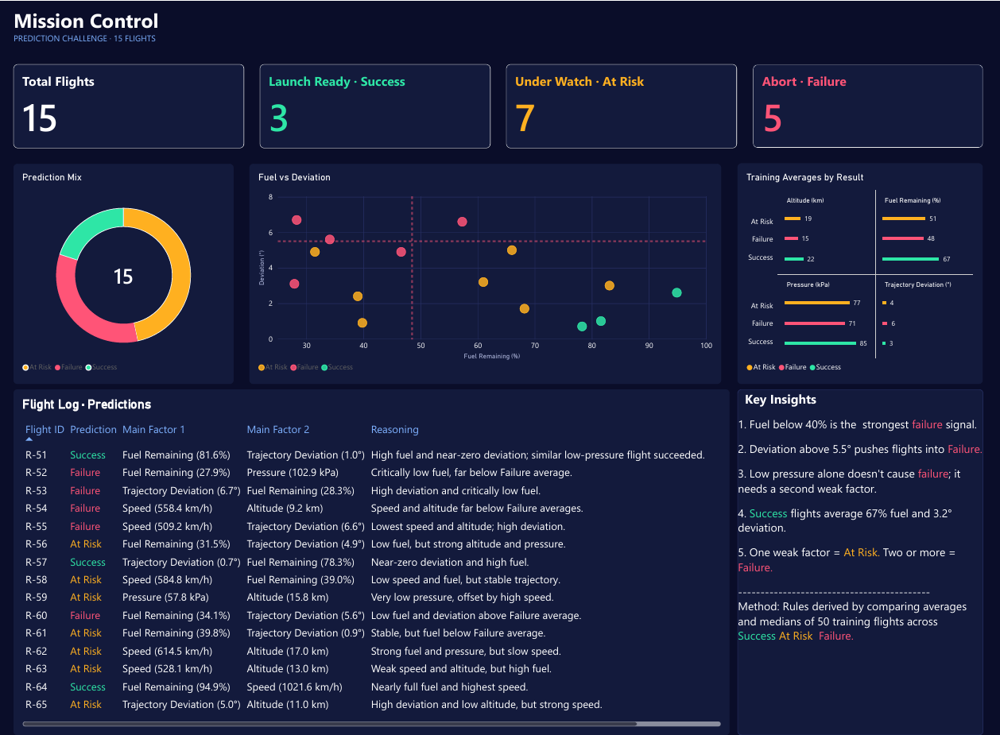

# 🚀 Mission Control: Rocket Flight Outcome Prediction

A data analysis project built for the **Prediction Challenge** by the Computer Club at Umm Al-Qura University.
The goal: study 50 historical (simulated) rocket flights, find the patterns behind each outcome, and predict the result of 15 new flights.

---

## 📌 The Challenge

| | |
|---|---|
| **Training data** | 50 historical flights with known results |
| **Challenge data** | 15 new flights, result hidden |
| **Prediction options** | Success · At Risk · Failure |
| **Scoring** | 70% prediction accuracy + 30% quality of reasoning |

Each flight is described by six variables: Engine Temperature, Speed, Altitude, Pressure, Fuel Remaining and Trajectory Deviation.

> These are simulated educational data, not real rocket-launch safety thresholds.

---

## 🔍 Approach

1. **Profiled the training data:** split the 50 flights by outcome (21 Success, 16 At Risk, 13 Failure).
2. **Compared averages and medians** of every variable across the three outcomes to find which factors separate them.
3. **Defined decision rules** from those comparisons.
4. **Scored each challenge flight** against the rules, and for borderline cases checked the closest similar flight in the training data.
5. **Visualized** the findings and predictions in a Power BI dashboard.

---

## 💡 Key Insights

- Fuel below **40%** is the strongest failure signal.
- Trajectory deviation above **5.5°** pushes flights into Failure.
- Low pressure alone doesn't cause failure; it needs a second weak factor.
- Successful flights average **67% fuel** and **3.2° deviation**.
- **One weak factor = At Risk. Two or more = Failure.**

### Training averages by outcome

| Outcome | Fuel (%) | Pressure (kPa) | Altitude (km) | Deviation (°) | Speed (km/h) |
|---|---|---|---|---|---|
| Success | 67.1 | 84.8 | 22.1 | 3.2 | 861.7 |
| At Risk | 50.9 | 76.9 | 18.7 | 4.0 | 814.0 |
| Failure | 48.5 | 71.5 | 15.4 | 5.5 | 701.7 |

---

## 🎯 Predictions

| Outcome | Flights | Share |
|---|---|---|
| ✅ Success | 3 | 20% |
| ⚠️ At Risk | 7 | 47% |
| ❌ Failure | 5 | 33% |

Full predictions with supporting factors are in the **Submission Template** sheet of the Excel file.

---

## 📊 Dashboard

The one-page **Mission Control** dashboard includes:

- **KPI cards:** total flights and count per predicted outcome
- **Prediction Mix:** donut chart of the outcome split
- **Fuel vs Deviation radar:** scatter plot with failure-average reference lines marking the danger zone
- **Training Averages by Result:** small-multiple bar charts comparing key factors
- **Flight Log:** every prediction with its main factors and reasoning
- **Key Insights:** the decision rules behind the predictions

---

## 🛠️ Tools

| Tool | Used for |
|---|---|
| **Excel** | Averages, medians (`AVERAGEIFS`, `MEDIAN(IF())`), sorting and filtering to find thresholds |
| **Power BI** | Power Query (unpivoting data), dashboard design and visuals |
| **Claude** | Drafting the reasoning and refining the dashboard layout |

---

## 📁 Files

| File | Description |
|---|---|
| `Rocket_Prediction.xlsx` | Training data, challenge data and submission template |
| `Mission Control.pbix` | Power BI dashboard |
| `dashboard.png` | Dashboard screenshot |

---

## 👤 Author

**Fares Althubyani**
[GitHub](https://github.com/FarisAlthubyani)
